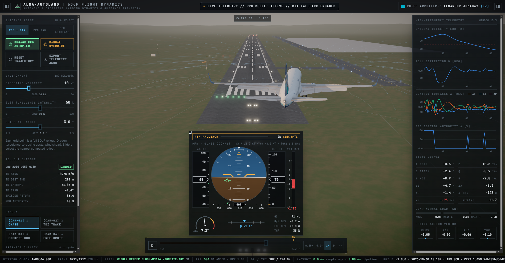
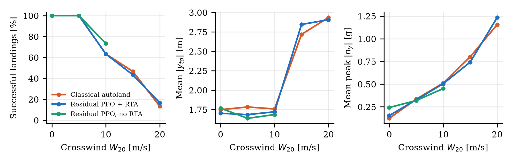
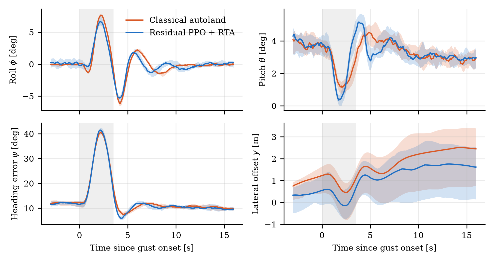

# Autonomous Crosswind Landing

**Nonlinear 6-DoF flight simulation, classical autoland, residual reinforcement learning with runtime assurance, and a WebGL mission console.**

**Author:** Almansur Jumabay, 11th grade, Dostyq School, Astana, Kazakhstan

🌐 **[Live demo](https://autonomous-crosswind-landing.netlify.app)** · 📄 **[Read the technical report (PDF, 7 pages)](Almansur_Crosswind_Project.pdf)** · 📘 [Full technical documentation](docs/TECHNICAL.md)



> **Project status.** All results come from simulation. Training is still in progress, and the policy evaluated so far is an interim snapshot. Hardware-in-the-loop integration (ESP32 / MPU-6050 / Web Serial) is a proposed design and has not been built.

## The problem

In a crosswind an aircraft approaches with its nose pointed into the wind, then must align with the runway within seconds of touchdown while gusts and wind shear disturb it. This project asks whether a learned policy can improve on a competent classical autoland without giving up safety.

## What is in the repository

| Component | Description | Location |
|---|---|---|
| Flight simulator | 13-state quaternion rigid body, RK4 at 100 Hz, stall and ground effect, landing gear contact, wind shear and veer, Dryden turbulence, 1-cosine gusts | `src/env/` |
| Classical autoland | Cascaded PID with wind estimation, flare, angle-of-attack protection and limited de-crab | `src/agents/baseline_autopilot.py` |
| Learned policy | PPO (Stable-Baselines3 / PyTorch) that adds bounded corrections to the autoland | `src/agents/train_ppo.py` |
| Runtime assurance | Simplex monitor with a 1 s look-ahead that blends authority back to the autoland | `src/agents/safety_supervisor.py` |
| Mission console | React and Three.js replay of recorded flights with instruments and airflow overlay | `src/web/` |
| Blender pipeline | Procedural airfield and airliner model, glTF export, cinematic renderer | `src/viz/` |
| Report experiments | Scripts behind every number and plot in the report | `src/viz/report_*.py`, `report/` |
| Tests | Integrator order, conservation laws, turbulence statistics, gust stability, reward properties | `tests/` |

The console shows an airliner as a visual model, while the flight data come from the simulator's Cessna-172-class aircraft. It is a visualisation, not evidence of airliner performance.

## Results

Successful landings out of 30 per condition, with turbulence and random gusts. Same seeds for every controller.

| Crosswind | Classical autoland | Residual PPO + RTA | Residual PPO, no RTA |
|---|---:|---:|---:|
| 5 m/s | 30 | 30 | 30 |
| 10 m/s | 19 | 19 | 22 |
| 15 m/s | 14 | 13 | not measured |
| 20 m/s | 4 | 5 | not measured |



- **The interim policy does not yet beat the baseline.** The 22 of 30 result is inside the statistical uncertainty of a sample this small. In strong wind the monitor hands most control back to the autoland.
- **Hard landings are the limiting factor,** not lateral tracking: mean touchdown error stays below 3 m at every wind level.
- **The analytic crab angle** matches simulation within 1.4° up to a 15 m/s crosswind.
- **A 20 m/s peak lateral gust** at about 58 m height: 19 of 20 trials land with either the autoland or PPO + RTA.
- **Decision time** is under 1 ms on a desktop CPU against a 50 ms control period. End-to-end hardware latency has not been measured.



## Quick start

Requires Python 3.12 and Node.js.

```bash
python -m venv .venv
.venv\Scripts\activate            # Linux/macOS: source .venv/bin/activate
pip install -r requirements.txt
pytest
```

Run the console, which uses the flight data and 3D scene included in this repository:

```bash
cd src/web
npm install
npm run dev                       # http://127.0.0.1:5173
```

Keys: `Space` play/pause, `1`–`4` cameras, `F` airflow overlay, `G` graphics quality.

The live demo is a Netlify build of `src/web`; the settings are in `netlify.toml`.

Train a policy, or reproduce the report's measurements:

```bash
python -m src.agents.train_ppo --total-timesteps 5000000 --n-envs 8 --run-dir runs/ppo_xwind
python -m src.viz.report_experiment --model report/model_snapshot/best/best_model.zip
python -m src.viz.report_figures
```

Checkpoints and training logs are not stored in the repository. `report_figures` also needs `runs/`, so its training plot requires a local run. The report's frozen policy is in `report/model_snapshot/`.

## Roadmap

- Finish training to 5 million steps, then repeat the evaluation with larger samples and gusts during the flare.
- Build the proposed hardware bench and measure real sensor and serial latency.
- Explore physics-informed neural networks for local airflow estimation.

## Acknowledgement

Parts of the software, visualisation and report were prepared with the assistance of an AI coding tool (Claude Code).
